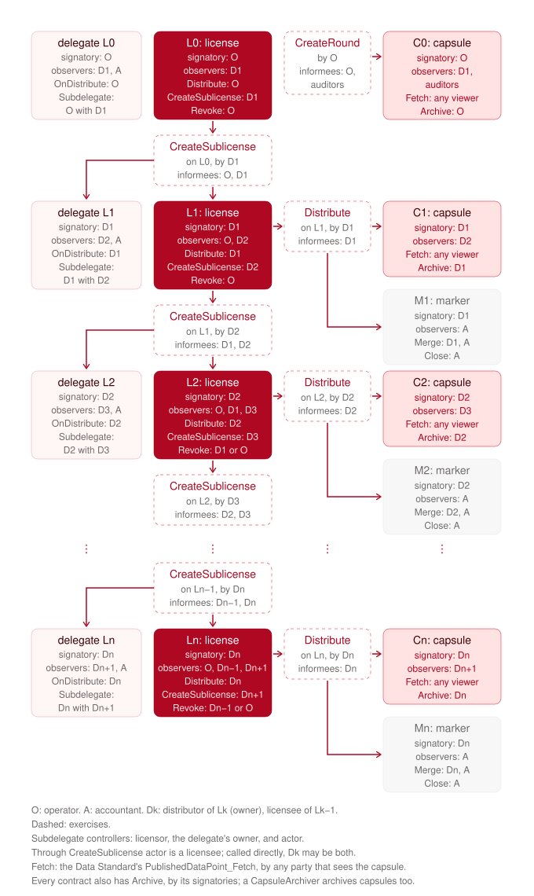

# Canton Access and Privacy Standard

CAPS, the Canton Access and Privacy Standard: Daml interfaces for a push
oracle whose fixings are canonical and recorded on-ledger, and whose
consumption is invisible to the oracle operator.

A data set is published in rounds. Each round is a price-free record visible
to the feed's readers, plus a root capsule carrying the data. Licensees
redistribute the data by deriving capsules scoped to their own clients. The
operator is a stakeholder of none of those capsules. A consumer proves what it
received with two local checks: authenticity, against a verifier it
instantiated itself, and canonicality, against the round it read from its own
participant.

The standard builds on the [Canton Data Standard](https://github.com/kaikodata/canton-data-standard):
every capsule implements its `PublishedDataPoint` interface, so a consumer
written against that standard reads a CAPS capsule unchanged, and payloads use
its `AnyValue` type.

## Packages

| Path | Package | What it is |
|---|---|---|
| `interfaces/caps-api-core-v1` | `caps-api-core-v1` | The seven interfaces: `DataDefinition`, `Verifier`, `RoundHead`, `Round`, `License`, `LicenseDelegate`, `Capsule`, plus the shared `CapsuleContent`, `CapsuleSource` and `CreateRoundResult` types. Views and choices only; no executable code, because an interface package cannot be smart-contract-upgraded. |
| `caps-core` | `caps-core` | The reference implementation of the five data-path interfaces, generic over the oracle: templates for `DataDefinition` (with its bootstrap proposal), `RoundHead`, `Round`, `License` and `Capsule`. The reference license calls its `LicenseDelegate`, when it names one. The only vendor-specific contract a deployment adds is a `Verifier`. |
| `caps-capsule-archiver` | `caps-capsule-archiver` | Retention for capsules, through the `RoundHead` and `Capsule` interfaces alone: a `CapsuleArchiver` of one distributor for one data definition archives, for any actor that sees it and names the definition's round head, the distributor's capsules at least `keptRounds` rounds behind the head's latest round once `keepPeriod` has passed since their publication, the retention a RedStone price pill follows. |
| `caps-round-archiver` | `caps-round-archiver` | Retention for rounds, through the `RoundHead` and `Round` interfaces alone: a `RoundArchiver` of the operator for one data definition retires, through `Round_Archive`, the rounds at least `keptRounds` behind the head's latest round once `keepPeriod` has passed since their fixing time, the capsule archiver's rule; the genesis round always stays. |
| `tests-fixtures` | `caps-tests-fixtures` | `TestVerifier`, a cryptography-free verifier for exercising the reference implementation. Templates only, so the package carries no `daml-script` dependency. |
| `tests` | `caps-tests` | Daml Script tests: bootstrap, publication and its rejections, the race on the head, pause, distribution by view and by id, sublicensing, revocation, the visibility claims, the RedStone verifier against payloads signed by test node keys, the Data Standard verifier against payloads signed by keys generated in the script, the capsule and round archivers on published rounds, and the extended licenses with the accounting delegate, its markers, merging and settlement. |
| `deps/` | | Vendored DARs: the Canton Data Standard (`utils-v1` for `AnyValue` and `datapoint-v1` for `PublishedDataPoint`, which the interfaces depend on; `codecs` and `distributor-key-v1`, which the Data Standard verifier delegates to) and the RedStone Daml SDK (`redstone-sdk-v20`, `redstone-common-v20`) the RedStone verifier delegates to. |

## The model

| Interface | Signatory | Role |
|---|---|---|
| `DataDefinition` | the publishing party, with the auditors in the reference | The data set's identity and anchor: `dataId` and the canonical `verifier`. Read-only; every round, capsule and license points at its contract id. |
| `Verifier` | whoever creates it | The oracle's signing and aggregation scheme as a contract. A consumer creates its own instance from the same template, so verifying has no informee but the consumer. `Verifier_Verify` proves authenticity, `Verifier_VerifyRound` canonicality, `Verifier_VerifyFreshness` the oracle's acceptance window around a reference time. |
| `RoundHead` | the publishing party, with the auditors in the reference | The head of the round chain and the publishing endpoint. One live contract per definition, consumed on every `RoundHead_CreateRound`, so round numbering is unique: two concurrent publications are a double spend of the head. Open to any publisher the implementation admits; the authority to sign the round comes from the contract, not from the caller. |
| `Round` | the publishing party, with the auditors in the reference | Immutable, price-free record of a fixing: round number, fixing time, a commitment to the data whose scheme the Verifier defines. Visible to the feed's readers. |
| `License` | its owner | A right to distribute and to sublicense. The root is owned by the publishing party; every sublicense by its licensee alone. `License_Distribute` creates a capsule for a list of clients from a source given by view (private) or by contract id (informs the source's signatory). A license may name a `LicenseDelegate`. |
| `LicenseDelegate` | the implementation's | What a license does on a distribution and a sublicense beyond creating the capsule or the child license. `LicenseDelegate_OnDistribute` is told of every distribution in the same transaction; `LicenseDelegate_Subdelegate`, with the authority of both owners, gives a sublicense its delegate. Its signatories learn of, and confirm, every distribution that calls it. |
| `Capsule` | its distributor | The unit of distribution. Requires `PublishedDataPoint`. Carries definition, round number, and `CapsuleContent`: data point, opaque signed payload, license. |

Two rules shape every signature. Verification takes views, never contract
ids, because a fetch informs the fetched contract's signatories; distribution
offers the view as the private option. And the data path is generic: an
oracle joins the standard by implementing `Verifier`.

### What a consumer checks

Five checks, specified in [docs/specification.md](docs/specification.md)
section 5 and walked through in
[docs/consumer-guide.md](docs/consumer-guide.md):

1. **Authenticity**: `Verifier_Verify` on its own verifier instance, created
   from the template the definition's `verifier` points to.
2. **Canonicality**: `Verifier_VerifyRound` with the `Round` view read from
   its own participant.
3. **Freshness**: `Verifier_VerifyFreshness` with the time it cares about,
   or its own bound on `content.dataPoint.publishedAt`.
4. **License**: the license's `owner` is the capsule's distributor and its
   `definition` matches, checked on the disclosed contract; provenance is
   policed, not proven.
5. **Chain**: the round's signatories are the definition's, as the Ledger
   API shows them; in the reference implementation both are the operator
   and the auditors, so a round nobody could have minted alone.

### What a publication touches

Every contract used in a transaction must be visible to the submitter's
participant, whatever authority the choice carries. In the reference
implementation a publication touches three existing contracts: the head it
consumes, the canonical verifier and the root license, whose licensees
become the root capsule's audience; the head carries the latest round's
number and fixing time, so no round is fetched. Publishing is therefore
open to whoever sees all three: the operator and the root license's
licensees by observation, anyone else by explicit disclosure of the three
contracts.

## Extensions

CAPS is open to extension. The standard fixes what a consumer checks and
what a distribution must not reveal, and leaves three places where a
deployment adds its own behaviour without touching the interfaces: the
oracle, through `Verifier`; the kinds of license, through `License`; and
what a distribution does beyond creating the capsule, through
`LicenseDelegate`. The packages under `extensions/` are one extension for
each. They combine freely, and a deployment replaces any of them with its
own. [docs/extensions.md](docs/extensions.md) describes the extension points
and how to write an extension.

| Path | Package | What it is |
|---|---|---|
| `extensions/caps-verifier-redstone` | `caps-verifier-redstone` | A `Verifier` for RedStone oracle data: the capsule payload is a RedStone payload as the nodes sign it, verified by the RedStone Daml SDK (keccak256, secp256k1, m-of-n distinct signers, median). The round commitment is the keccak256 of the signed payload, which every capsule carries verbatim. |
| `extensions/caps-verifier-datastandard` | `caps-verifier-datastandard` | The standard's default `Verifier`, for data signed in the Canton Data Standard's own envelope: the data point is the signed content, the payload carries `expiresAt` and one signature per node, and `DataStandard.Codecs.Verify` checks them against m-of-n configured keys. The round commitment is the envelope's structural root hash, the Data Standard's `canonicalHash`. |
| `extensions/caps-extended-licensing` | `caps-extended-licensing` | License kinds beyond the reference: the open `OpenLicense` (paid by use, sublicensable, the root) and the prepaid `ConsumableLicense`, `SubscriptionLicense` and `CreditLicense` a sublicense is created as, selected by its `licenseType`. Each reports its distributions, priced, to its delegate. |
| `extensions/caps-accounting` | `caps-accounting` | The reference implementation of accounting, as a `LicenseDelegate`: `AccountingDelegate`, signed by its owner and observed by its accountants and the licensees who sublicense through it, leaves a `DistributionMarker` per distribution its owner reports, signed by the distributor and observed by the accountants, which either side merges and the accountants settle. Serves any license that names it: at the weight the license passes in the context, or at 1.0 when it passes none. |

### Accounting (optional)

`caps-accounting` is accounting built on `LicenseDelegate`. A license that
names an `AccountingDelegate` leaves a `DistributionMarker` for every
distribution it makes, created in the same transaction as the capsule, so
that a distribution made through the license cannot go unrecorded. The
marker names the distributor, the accountants it is reported to, the
definition, the license, the rounds, a count and the weight the license
priced the distribution at, and binds itself to the capsule it accounts for.
The marker is signed by the distributor and observed by the accountants,
so no accountant's participant is needed for a distribution. The
accountants learn that and when a distribution occurred, under which
license and for which round, but not its audience or the capsule's
content.

Along a chain of open licenses with accounting delegates, from the operator
O down to Dn, each contract and exercise is seen and exercised as follows.
Without a delegate the license, capsule and exercise boxes stay as they are,
and the delegates and markers are absent.



## Documentation

[docs/README.md](docs/README.md) is the index. In short:

| Document | What it is |
|---|---|
| [specification.md](docs/specification.md) | The normative requirements on a deployment, a verifier and a consumer, interface by interface. |
| [data-model.md](docs/data-model.md) | Every type, view and field; identity; payload encodings; lifecycle and visibility tables. |
| [consumer-guide.md](docs/consumer-guide.md) | Onboarding and the five checks, with Daml Script fragments. |
| [implementer-guide.md](docs/implementer-guide.md) | Writing a verifier, publishing with an existing oracle, what may be replaced. |
| [extensions.md](docs/extensions.md) | The extension points, the shipped extensions, writing an extension. |
| [governance.md](docs/governance.md) | Who signs the head and the rounds, the variants considered, the decision. |
| [lifecycle.md](docs/lifecycle.md) | How each contract is created, replaced and retired; retention; open gaps. |
| [licensing.md](docs/licensing.md) | The license, provenance, what a client can check, the license kinds. |
| [accounting.md](docs/accounting.md) | The optional distribution marker, merging, settlement, variants, audit. |
| [threat-model.md](docs/threat-model.md) | What CAPS proves, polices and leaves out of reach. |
| [glossary.md](docs/glossary.md) | The terms. |

## Build

Requirements: `dpm` (the Daml Package Manager) with Daml SDK `3.5.12`
(`dpm install 3.5.12`), and a JDK (17+).

```bash
make build          # dpm build --all
make test           # run the Daml Script test suite
make validate       # validate the built interface DARs
make lint           # dlint over the Daml sources
make headers-check  # every source file carries the license header
make dars           # refresh the committed DARs in dars/
make dars-check     # prove the committed DARs match a from-source rebuild
make clean          # dpm clean --all
make ci             # headers-check, build, validate, test, dars-check
```

## License

[Apache-2.0](LICENSE)
